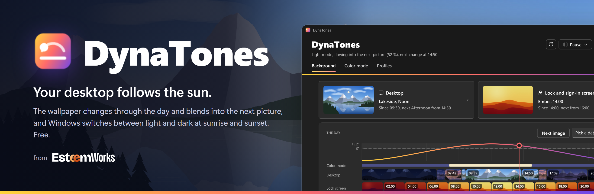
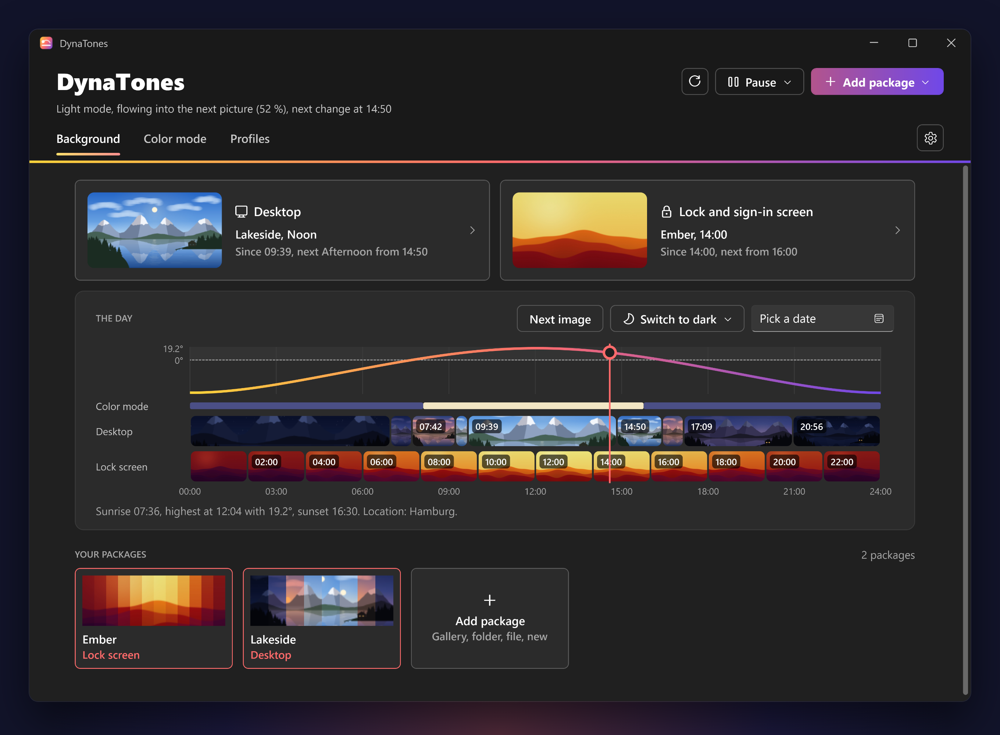
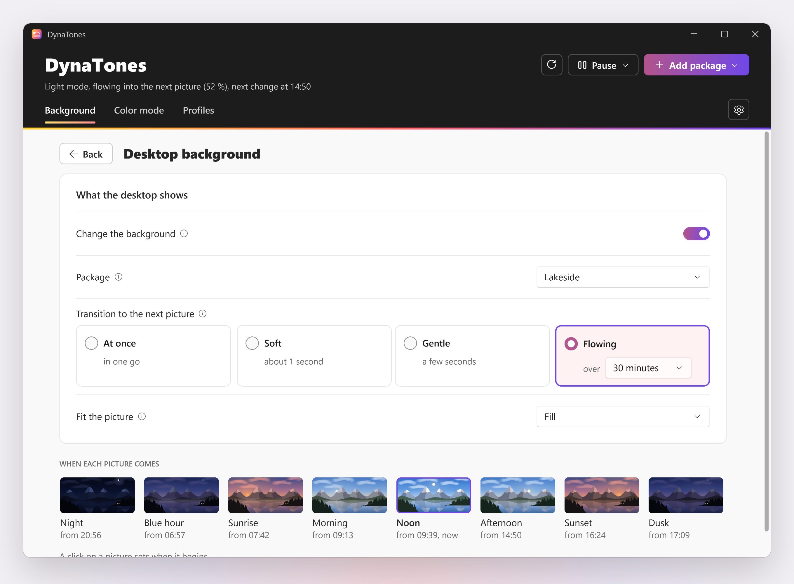
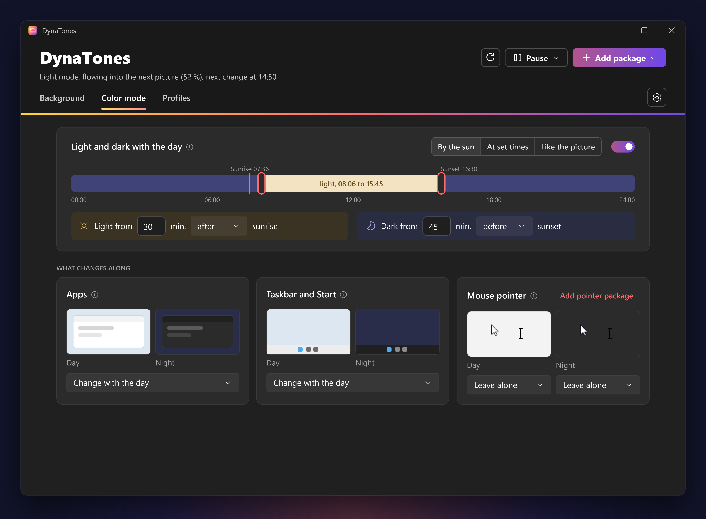
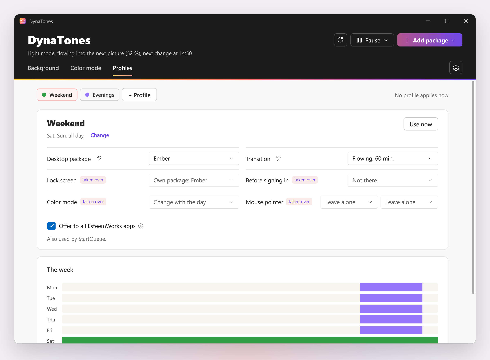
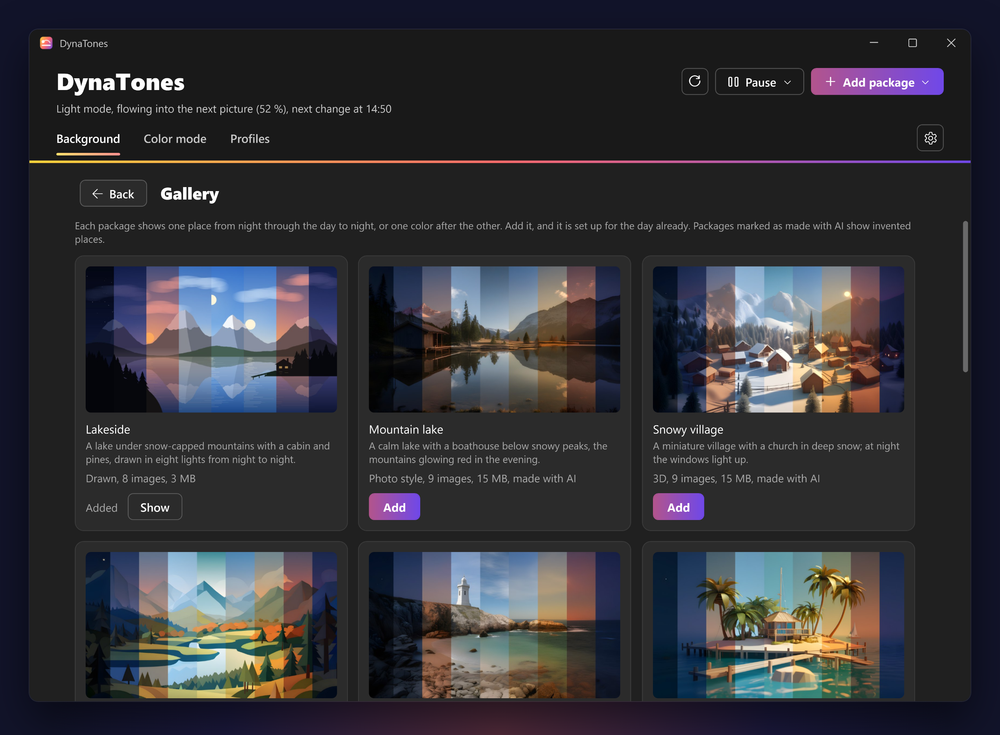
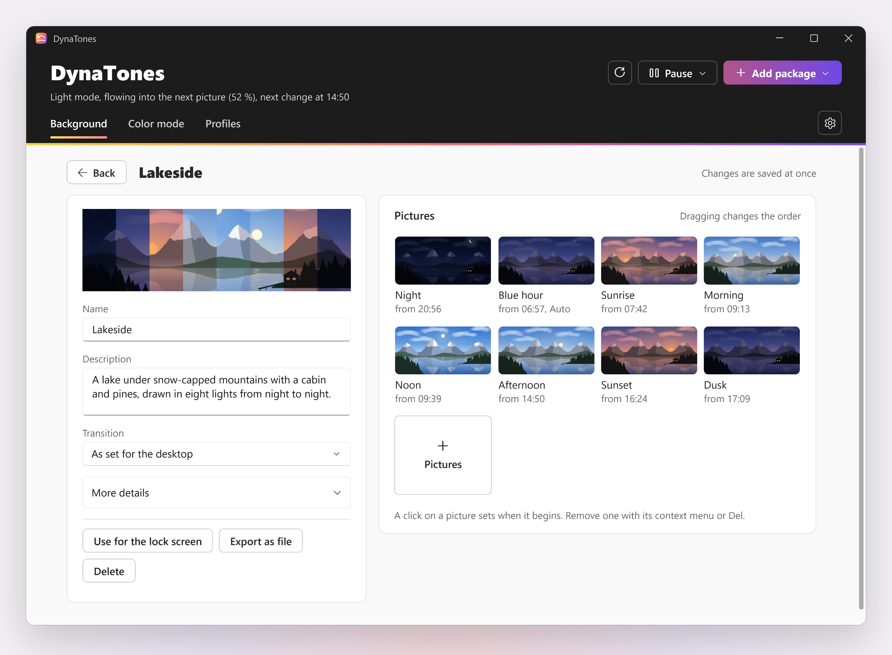
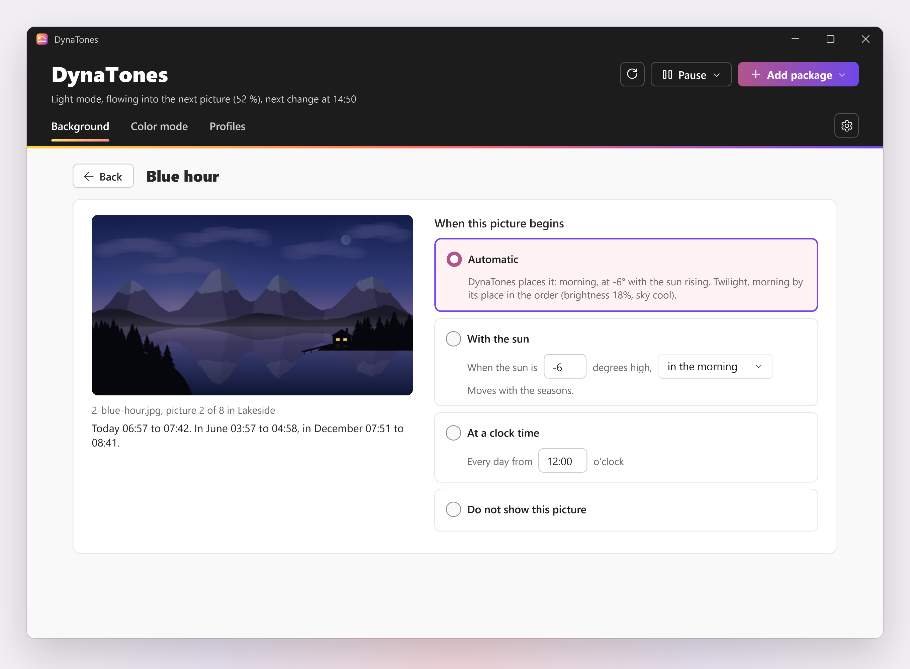
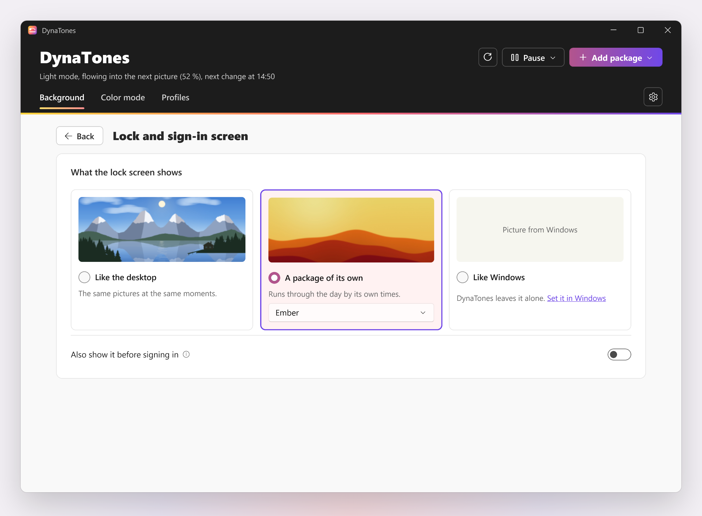
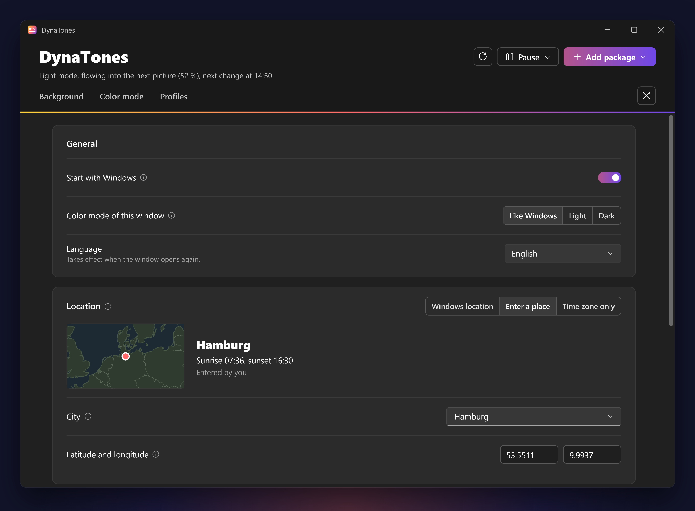

<p align="center">
  
</p>

<h1 align="center">DynaTones: dynamic wallpapers and the color mode for Windows</h1>

<p align="center">
  <b>Your desktop follows the sun.</b><br>
  The wallpaper changes through the day, image by image, and Windows switches its color mode at sunrise and sunset,<br>
  all from one calculation of where the sun stands at your place. Free.
</p>

<p align="center">
  
  
  
  
  
</p>

---

On Windows your wallpaper stays the same all day. The slideshow changes pictures on a timer, whether it is noon or
night, and dark mode only comes when you switch it yourself.

**DynaTones** does both from one plan. Every image of a package gets its moment on the sun's arc, sunrise, noon,
sunset or night, and stays until the next one starts. The color mode of apps, of Windows and even the mouse pointer
can follow the sun, fixed times or the image that is shown. It works out the sun right where you are, also where
Windows location is switched off, and it puts the wallpaper back when something else changed it.

<picture>
  <source media="(prefers-color-scheme: light)" srcset="docs/images/hero-light.png">
  
</picture>

## See it in action

**[Watch the film](https://esteemworks.github.io/dynatones/)** (1:44, plays in your browser, sound on): outside the window
the sun goes down, on the screen it is still noon. Then DynaTones: screen and window follow the same sun through a day,
the slow blend from night to the blue hour, dark mode with the sunset, your own photos, the lock screen, a city where
location is off, and templates for IT.

## Highlights

### Every image at its moment
Each picture shows when the light outside matches it: the sunrise at sunrise, the night at night, and the one in between
until the next one is due. It is worked out for where you live, so twilight and golden hour fit in June and in
December, and a noon picture still shows at noon in winter. Three pictures cover a day as well as sixteen. **Next image** shows the coming picture now and keeps the day one step ahead until its own time.

### Light that flows
No change of picture is cut off. Three ways from one image to the next: soft (a short fade of about a second), gentle
(three mixed steps in the last few seconds) or flowing: DynaTones mixes the two in small steps, about one a minute,
over the last 10, 30 or 60 minutes. A theme that shows the same place in other light then changes as slowly as the light
itself. A package can have a transition of its own. Next image, a switch to dark or light with its picture and Back to
the plan fade too, and the color mode changes halfway through the fade.

### Ready from the first start
DynaTones brings "Lakeside", a drawn lake in eight lights, and shows it from the first start. The **gallery** under
Add package has more, each added with one click and already set up for the day: ten places from night to night in photo
style, 3D and flat 2D, and three color packages that go through twelve colors a day. The places were made with AI and
are marked as such; they show invented places, without real buildings, brands or people.

### Your own pictures
Add a folder of images, a `.zip` or a WinDynamicDesktop `.ddw`, by button or by dropping it on the window, or start a
new package of your own. **Auto** places each image from what is known about it: the time and place stored in a photo,
the part of the day a theme names, or how bright and warm it looks compared with the rest. Or pin an image yourself,
to an elevation of the sun ("4° rising") or to a clock time ("from 07:30"). On a package's page you give it a name and
a description, add pictures, drag them into another order, remove them, and export the package as one `.zip` for
another PC.

### The color mode with it
Light from sunrise and dark from sunset ("light from 30 minutes after sunrise"), at fixed times, or following the
image: dark while the image shown belongs below the horizon. The day shows as a band with a handle at each switch to
drag. Apps, taskbar and Start, and the mouse pointer each have a small picture of day and night above their choice. A
pointer package (a folder or `.zip` with `.cur` and `.ani` files) is added with one click, for your user only.

Dark now, or light now, from the tray or next to **Next image**: **Switch to dark** changes only the color mode and
keeps the picture; **Next dark phase, with its picture** shows both as they will be when dark next begins, the
picture of that moment included. Either holds until the plan gets there by itself, then the day goes on as planned.
While paused, it stays as you set it until you resume.

### Profiles
Other settings at other times: a profile can set its own package, transition, lock screen, color mode and pointer;
everything else is taken over from Background and Color mode. Profiles are shared with StartQueue and the other
EsteemWorks apps: one offered there can be taken over here, and one schedule switches them all. The week shows which
profile applies when.

### The lock screen with it
Under **Background > Lock and sign-in screen**, the lock screen follows the day too: with the desktop's images at the same moments, or
with a package of its own. DynaTones sets it the way Windows Settings does, and you can pick
another picture there at any time. Windows spotlight is only switched off when you ask for it, and switched back on
when you change your mind. With the installation with admin rights, the screen before anyone signs in can show the
same picture of the day; Windows takes it over the next time the PC is locked or starts.

### Works where location is off
DynaTones takes the first position that works: Windows location, a city or coordinates you enter, or an estimate from
the time zone. Settings > Location shows it on a small map with the place by name ("Near Melle, Germany"), from data
built into the app: nothing is looked up online. On many company devices Windows location is switched off by policy; DynaTones says so and goes on with
the next. Without any position, fixed times still work.

### Stays on track
A wallpaper that another tool replaced, or one that stuck after sleep or unlock, is put right. DynaTones checks at
the exact time of the next change, after waking up, unlocking, a changed clock or a new monitor, and once a minute.

### Ready for organizations
Every setting can be set through Group Policy, Intune or other management tools, either fixed or as a default users
can change. See [For organizations](#for-organizations).

## Screenshots

<table>
  <tr>
    <td width="50%"><br><sub><b>Desktop:</b> package, transition, fit, and when each picture comes</sub></td>
    <td width="50%"><br><sub><b>Color mode:</b> by the sun, at set times or like the picture, with what changes along</sub></td>
  </tr>
  <tr>
    <td width="50%"><br><sub><b>Profiles:</b> other settings at other times, shared with the EsteemWorks apps</sub></td>
    <td width="50%"><br><sub><b>Gallery:</b> more packages, each set up for the day already</sub></td>
  </tr>
  <tr>
    <td width="50%"><br><sub><b>Your package:</b> name it, add pictures, sort them, export it</sub></td>
    <td width="50%"><br><sub><b>One picture:</b> automatic, with the sun, at a clock time, or not at all</sub></td>
  </tr>
  <tr>
    <td width="50%"><br><sub><b>Lock screen:</b> like the desktop, a package of its own, or like Windows</sub></td>
    <td width="50%"><br><sub><b>Settings:</b> the location by name and on a map, nothing looked up online</sub></td>
  </tr>
</table>

The pictures show the drawn packages "Lakeside" and "Ember", Hamburg as an entered place and two sample profiles,
drawn from the app itself with `--snapshot` in Windows Sandbox, without real data.

## Download and install

Download `DynaTones-Setup-<version>.exe` from the [latest release](../../releases/latest) and run it. It runs on Windows 11 and 10 and brings its own .NET. Wallpaper,
color mode, mouse pointer and lock screen work without admin rights; the full feature set needs an installation with
admin rights (one UAC prompt).

| | Installed with admin rights | Installed without |
| --- | --- | --- |
| Wallpaper, color mode, mouse pointer, lock screen | yes | yes |
| The screen before signing in follows the day | yes | not available |
| Start with Windows | yes | yes |
| Installation for all users of the device | with `/ALLUSERS`, see [docs/ADMIN.md](docs/ADMIN.md) | not available |
| Important events in the Windows event log | yes | only in the log file |
| Policies of the organization | read and respected | read and respected |

With StartQueue installed, StartQueue starts DynaTones at sign-in; the switch Start with Windows then turns
StartQueue's entry on and off. The event log can be set up later under **Settings > About > Troubleshooting**. A newer setup updates in place; your
packages and settings stay. Installed for you alone, DynaTones looks for a new version on GitHub once a day, when you
leave the setup's box ticked; it shows it in the tray and under **Settings > About > Updates**, and installs it with
one click (or by itself, if you switch that on). Uninstall through **Windows Settings > Apps**: start at sign-in and the program go, Windows
spotlight comes back if DynaTones switched it off, your packages stay for a later installation, and the wallpaper,
lock screen picture and color mode stay as they are at that moment.

> [!NOTE]
> The setup is not signed with a public code signing certificate yet. Windows SmartScreen therefore warns about an
> unknown publisher: choose "More info", then "Run anyway". With Smart App Control or policies like AppLocker, WDAC or
> ASR rules, Windows may block it.
> On VirusTotal one of 65 scanners flags the setup of version 0.5.0 (DeepInstinct, a machine-learning scanner, without
> naming a threat); the other 64 find nothing: [report](https://www.virustotal.com/gui/file/6c97b58dffbd146034dd4635485e03f23af1e8781c7f5272dd5046a62ae0bf8e).

## How it works

- **Every image has a place on the sun's arc.** It starts when the sun reaches that point, rising or setting, and
  stays until the next image starts. Three images cover the day as well as sixteen.
- **Near the horizon the real elevation counts**, so twilight and golden hour look right in June and in December.
  **High up and deep down, today's share of the arc counts**: a noon image still shows at noon in December, when the
  sun only gets to 14° in northern Germany.
- **Auto** places each image from what is known about it: the time and place in the photo's data, the part of the day
  a WinDynamicDesktop theme names, or how bright and warm it looks compared with the rest of the package. Packages
  made from macOS wallpapers (light image, dark image, then the day) are recognized.
- **By hand**, an image can be tied to an elevation ("4° rising") or to a fixed time ("from 07:30"), or left out.
- A package without morning images borrows its evening images for the morning, darkest first, and the other way round.
- **Flowing transitions** mix the current and the next image in up to 30 steps before the change, each a file of its
  own made at the size of the screens (a 9K photo is read at 4K for a 4K screen, in about half a second). Only the step
  on screen and the one before are kept; Windows fades between them.

One function compares what should be on screen with what is and changes only what differs. It runs at the exact time
of the next change, after waking up, unlocking, a changed clock, a new monitor or someone else setting a background,
and once a minute as a safety net. A background that another tool replaced is put back within a minute, with a line
in the log.

The sun is calculated on the device, per minute and with daylight saving time. A package is copied into DynaTones'
data folder, so it keeps working when the source moves.

## Keyboard and mouse

| Key | What it does |
|---|---|
| F5 | Update now: settings and location read again, background and color mode set for this moment |
| Ctrl+N | Add a package: gallery, folder or file |
| Esc | One page back under Background, out of the gallery |
| Esc | Close the settings, or cancel a question |
| Enter | In a field: take the value |
| Middle mouse button | Scroll by moving the mouse |

The settings open with the gear at the right end of the tabs; while they are open it turns into ×.

## FAQ

**Which images work?**
JPG and PNG, in a folder, a `.zip` or a WinDynamicDesktop theme (`.ddw`). HEIC is on the [roadmap](ROADMAP.md).

**How many images does a package need?**
Two or more. Three cover the day; more make it smoother. A package without morning images can borrow its evening
images for the morning, darkest first.

**Does DynaTones need my location?**
No. Windows location is used only if Windows allows it. Without it, enter a city or coordinates, or let DynaTones
estimate from the time zone; then sunrise and sunset can be off by up to half an hour, and the window says so.

**What if my organization fixes the wallpaper?**
DynaTones notices the policy, leaves the wallpaper alone, says why and keeps switching the color mode.

**Does it change the lock screen?**
Only when you choose so under Background > Lock and sign-in screen: like the desktop, a package of its own, or like Windows. Then the picture of your lock screen follows the day. The
screen before anyone signs in follows too when you also switch on "Also the screen before signing in", which needs
the installation with admin rights and applies to every user of the PC. Some editions of Windows leave that screen
out; the setting then says so.

**Where do the gallery's pictures come from?**
"Lakeside" and the color packages are drawn. The ten places were made with AI: SDXL 1.0 (license CreativeML Open
RAIL++-M) drew one picture of each place, the same model then painted it again in every light with its shapes held in
place, and Real-ESRGAN enlarged them to 5120 x 2880. They show invented places, and the app says so wherever a package
is shown. How they are made is in [tools/packages](tools/packages/README.md).

**Does DynaTones send any data?**
No. It works entirely on your device, without telemetry or account. It goes online only for the update check, once a
day while it is on, and for the gallery, when you open it: both ask GitHub for a file and send nothing about you. See
[Privacy](PRIVACY.md).

## Your settings

A newer version takes your settings over as they are, and DynaTones keeps the last five copies of them under
`backups` in its data folder, made before every update, import or restore. Under **Settings > About > Backup and
restore** you can save them to a file, load them on another PC, or go back to an earlier copy; from the command line
with `--export <file.zip>` and `--import <file.zip>`. Your image packages are not part of it; add them again from
their folder.

## Privacy

Everything stays on the device in `%APPDATA%\DynaTones`. The outside sources are Windows' own location service, only if
Windows allows it, the update check and the gallery. Details in [PRIVACY.md](PRIVACY.md).

## For organizations

DynaTones can be steered through Group Policy, Intune, Matrix42 or any tool that writes the registry, with ADMX
templates instead of scripts: the wallpaper, a managed image package, whether users may add their own, a gallery of
the organization's own on a share or switched off, the lock screen,
the color mode, where the sun is calculated, the language and start at sign-in. Every policy can be fixed (greyed out
with "Set by your organization") or given as a default users can change, and fixed values never overwrite the user's
own settings. `DynaTones.exe --write-admx <folder>` writes the templates.

Silent installation, importing the templates into Group Policy and Intune, every policy with its registry value, the
event ids and support from the command line are in [docs/ADMIN.md](docs/ADMIN.md).

## Troubleshooting

Under Settings, About, **Troubleshooting**: diagnostics mode writes every detail to the log for 24 hours and then turns
itself off; **Create diagnostics package** puts a zip on the desktop with the log, the policies in effect, DynaTones'
event log entries, what is on screen and the settings with the position rounded to about 10 km. Nothing is sent; you
decide whom you give it to.

The log is `%APPDATA%\DynaTones\DynaTones.log`. Important events also go to the Windows event log (Application,
source **DynaTones**) once it is set up: by the setup's admin option, offered to administrators, or with **Set up**
under Troubleshooting. Both ask for admin rights once. The event ids and the same from the command line are in
[docs/ADMIN.md](docs/ADMIN.md#support).

## Build from source

Requirements: the .NET 10 SDK. `dotnet build src\DynaTones` and `dotnet test tests\DynaTones.Tests` work as they are:
the family's kit comes compiled from `kit\` (not open source, see `kit\LICENSE.txt`). With the EsteemWorks.Kit
sources next to this repository, the build takes them instead. The setup is built only by EsteemWorks;
`build.ps1 -Setup` needs the kit's sources and Inno Setup 6 (`winget install JRSoftware.InnoSetup`).

```powershell
.\build.ps1 -Test        # tests, then the app in out\app
.\build.ps1 -SelfContained
.\build.ps1 -Setup        # also out\setup\DynaTones-Setup-<version>.exe, from the family's setup template
.\build.ps1 -Setup -KitPackage   # the app with the kit from kit\ even with the sources next to it, as for a release
.\tests\sandbox\run-sandbox.ps1 -WorkFolder <empty folder> -Packages <folder with images>
```

The sandbox test installs DynaTones with its setup and lets it really change a desktop, in Windows Sandbox without
network: night, the clock jumping to noon and dusk, a background set by someone else, coordinates entered by hand and
a policy that blocks the background, then the lock screen following the day and following a jump of the clock. Each step is checked against DynaTones' own plan. At the end it uninstalls DynaTones and checks that start at
sign-in, the family entry and the program folder are gone and the settings stay. Results and screenshots land in
`<folder>\results`. `-Test policy` checks the Group Policy templates in the policy editor and what DynaTones makes of
each policy; `-Test log` installs with the admin option and checks the event log, diagnostics mode and the package;
`-Test gallery -Gallery <folder>` checks that "Lakeside" is on screen from the first start and adds packages from a
gallery in a folder, also one whose download does not match; `-Test theme` opens the settings and switches Windows
between light and dark underneath, checking that page and drop-down fields change together; `-Test update
-NewerSetup <setup>` lets the installed version find the newer setup in a local feed and update itself. `-Setup <file>`
installs that setup instead of the newest in `out\setup`, for example the last release's, to test the update users
get. `-Test shots -Language de` draws the README pictures with the window in German.

Command line: `--show`, `--autostart`, `--plan <file> [package]` (today's plan as text),
`--import-package <source> <file>` (imports an image package and writes what was suggested),
`--gallery <file>` (the gallery's packages) and `--gallery-add <id> <file>` (adds one), `--next` (Next image in the running DynaTones), `--switch-mode` (the other color mode) and `--jump-mode` (the next phase of the other mode with its picture),
`--export <file.zip>` and `--import <file.zip>` (the settings, see "Your settings" above),
`--snapshot <folder>` (all pages as PNGs, off screen, screen by screen down to the end),
`--diagnostics [folder]`, `--diagnostics-mode on|off|<hours>`. For the setup:
`--setup`, `--uninstall`, `--prepare-update`, `--updates on|off`; after its own update the app starts with
`--updated`. `DYNATONES_UPDATE_FEED=<file or address>` stands in for the GitHub release in tests, and
`DYNATONES_GALLERY=<folder or address>` for the gallery. With `DYNATONES_DRYRUN=1` DynaTones calculates and shows
everything but changes nothing; `DYNATONES_DATA=<folder>` moves its data for tests.

`build.ps1 -Setup` signs the program, the setup and its uninstaller when signing is set up on the PC (environment
variables, see the kit's `tools\sign.ps1`); otherwise it builds them unsigned and says so in one line.

## Roadmap and changes

What is planned next, such as HEIC images and a package per monitor, is in the
[roadmap](ROADMAP.md). What changed is in the [changelog](CHANGELOG.md). Found a security issue? See
[SECURITY.md](SECURITY.md).

## Made with AI

DynaTones was developed with the help of AI: large parts of the code and texts were created with Claude by Anthropic,
directed and tested by the author. The app itself contains no AI and sends no data to AI services. The places in
the gallery were made with AI image models and are marked as such, see the FAQ.

## Thanks for the ideas

WinDynamicDesktop (sun-based wallpapers on Windows), Auto Dark Mode (light and dark switching, the
compare-and-apply loop), macOS dynamic wallpapers and Equinox (solar positions per image). DynaTones takes ideas from
them, no code.

## Data in the app

- Place names: [GeoNames](https://www.geonames.org), places with at least 15,000 inhabitants, licensed CC BY 4.0
  (`tools/cities.py`)
- The map under Location: [Natural Earth](https://www.naturalearthdata.com) 1:50m land and borders, public domain
  (`tools/map.py`)
- The main city of every time zone: the IANA time zone database, public domain

## More from EsteemWorks

DynaTones is part of the EsteemWorks family of small Windows tools that work on their own and look alike. Its sibling
[StartQueue](https://github.com/esteemworks/StartQueue) starts your apps after sign-in in your order.
